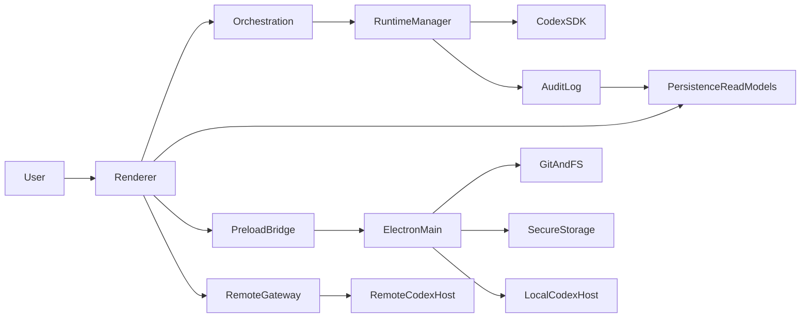

# Takomi Code System Architecture

## Overview

Takomi Code is a shared React + TypeScript product delivered through two shells:

- an Electron desktop application for native workspace, Git, secure storage, and local runtime powers
- a browser-compatible web application for cloud-connected orchestration and browser-safe execution flows

The architecture keeps Takomi orchestration at the center and makes Codex SDK the primary runtime integration. Electron main and preload own native access. The renderer stays browser-safe and reaches native powers only through typed IPC contracts.

## Architectural Principles

- One product, two shells: desktop and browser share UI, contracts, orchestration logic, and event models wherever possible.
- Codex SDK first: runtime execution is modeled around a dedicated runtime manager, not direct UI-driven process control.
- Typed boundaries: renderer, preload, main, remote services, and persistence layers communicate through explicit contracts.
- Performance-first streaming: transcript updates, task-graph changes, and audit feeds must remain responsive under heavy event volume.
- Workspace-aware orchestration: projects, workspaces, worktrees, parent/child sessions, and recovery flows remain core system concepts.

## Target Package Map

- `apps/desktop`
  - Electron main process
  - Electron preload bridge
  - desktop bootstrapping for the shared renderer
- `apps/web`
  - browser shell
  - remote service integrations
  - browser-safe entrypoints for the shared renderer
- `packages/contracts`
  - shared TypeScript types
  - runtime schemas
  - IPC contracts
  - audit event envelopes
- `packages/orchestration`
  - Takomi mode/workflow loading
  - task graph execution rules
  - parent/child session relationships
  - intervention and recovery policies
- `packages/runtime-codex`
  - `CodexRuntimeManager` contract
  - Codex SDK session lifecycle adapters
  - event normalization and stream fan-out
- `packages/persistence`
  - repository interfaces
  - desktop storage adapters
  - browser storage adapters
  - event-log and materialized-view helpers
- `packages/ui`
  - design tokens
  - layout primitives
  - feature surfaces
  - desktop and browser responsive variants

## Major Subsystems

### 1. Shared Renderer

The shared renderer contains the product shell, session explorer, transcript surface, task graph, inspector, settings, billing, and verification flows. It assumes no direct Node.js or OS access.

Key responsibilities:
- render project, session, and runtime state
- dispatch orchestration and intervention intents
- consume streaming runtime events
- surface desktop-only actions with explicit capability checks

### 2. Electron Main and Preload

Electron main hosts the desktop-only capabilities:
- local workspace open/create/clone flows
- filesystem and artifact access
- Git status and worktree operations
- secure token and secret storage
- OS dialogs and desktop notifications
- local Codex SDK session hosting

Electron preload exposes a typed bridge to the renderer. The preload surface is the only allowed native entrypoint for React code.

### 3. Takomi Orchestration Core

The orchestration core loads Takomi modes and workflows, builds task graphs, creates parent/child session trees, tracks dependencies, records artifacts, and coordinates interventions and recovery flows.

It owns:
- orchestration session ids
- task ids and dependency edges
- parent/child session relationships
- workspace inheritance rules
- recovery state and retry history

### 4. Codex SDK Runtime Layer

The runtime layer centers on a `CodexRuntimeManager` contract with at least two implementations:

- `DesktopCodexRuntimeManager`
  - runs in Electron main
  - hosts local Codex SDK sessions for desktop workspaces
- `RemoteCodexRuntimeManager`
  - used by the browser build and optional desktop cloud mode
  - connects to a remote service that owns Codex SDK session execution

Both implementations emit the same normalized event stream so the renderer and orchestration core can remain target-agnostic.

### 5. Persistence and Audit Layer

Persistence is append-first and performance-aware:
- event history stores transcript chunks, runtime events, interventions, and audit events
- read models denormalize session lists, task summaries, and restore snapshots
- desktop storage favors local durable databases and file-backed artifacts
- browser storage uses browser-safe stores for cache and session continuity, with remote backing where required

Audit logs are first-class product outputs, not debug leftovers.

### 6. Workspace and Git Layer

Workspace state includes:
- root workspace identity
- current branch and dirty state
- explicit worktree assignments
- inheritance relationships between parent and child sessions

Same-workspace inheritance is the default. Worktree switching is a deliberate mutation applied to a selected session subtree.

### 7. Billing and Verification Layer

Paystack billing and Bags verification remain isolated integrations with shared UI surfaces and audit trails. Desktop may assist with secure storage and external window handling, but the feature contracts remain shell-agnostic.

## Desktop-Only vs Browser-Safe Capabilities

### Desktop-Only

- local filesystem browsing and workspace attachment
- direct local Git inspection and worktree mutation
- local secure secret storage
- local Codex SDK runtime hosting
- OS notifications and native dialogs

### Browser-Safe

- viewing and continuing cloud-backed sessions
- task graph creation and monitoring
- transcript review and intervention UI
- billing and entitlement flows
- Bags verification flows through remote APIs
- audit and artifact review where assets are remotely accessible

### Fallback Rule

If a capability is desktop-only, the browser build must either:
- use a remote service path with the same contract, or
- present a clear unavailable state with next-step guidance

## Data Flow

## Performance Strategy

- Stream events into stores incrementally and derive view models outside React render functions.
- Keep transcript rendering append-oriented and virtualized for long sessions.
- Separate high-frequency runtime event ingestion from slower layout recalculation.
- Persist event history asynchronously so disk or network writes do not block interaction.
- Prefer optimistic UI only where auditability is preserved and reconciliation is explicit.

## Security and Trust Boundaries

- Preload is the trust boundary between renderer and native powers.
- Shared contracts validate IPC payloads and remote payloads consistently.
- Secrets and tokens must never be stored in renderer-managed plain-text state.
- Audit logs record who triggered a run, intervention, entitlement change, or verification event and how it resolved.

## Acceptance-Critical Decisions

- Codex SDK is the runtime foundation.
- Electron is the desktop shell, not the business-logic center.
- Shared React packages define the product experience across desktop and web.
- Native powers are never exposed through untyped or direct renderer access.
- Same-workspace inheritance and explicit worktree switching are preserved as core behavioral rules.
