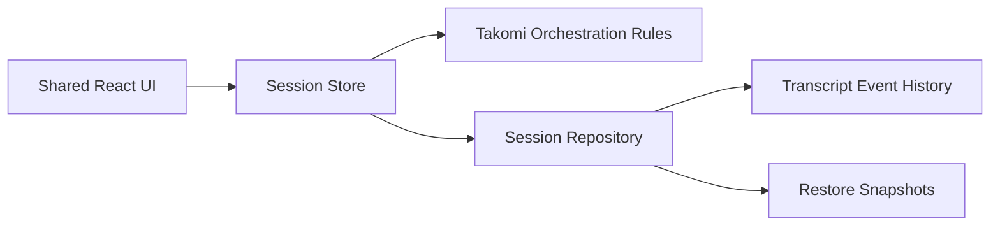

# Chat Session Core

## Overview

The chat session core provides workspace-scoped chats, parent/child session relationships, durable transcript restore, and shared React state for the Takomi orchestration experience. It is the backbone for transcript rendering, task execution, recovery, and audit correlation.

## Package Ownership

- `packages/contracts`
  - chat session entities
  - transcript event types
  - parent/child relationship metadata
  - workspace/worktree references
- `packages/orchestration`
  - session creation rules
  - parent/child lineage logic
  - inheritance rules
- `packages/persistence`
  - session repository
  - transcript event store
  - restore snapshots
- `packages/ui`
  - session explorer
  - transcript workspace
  - session tab and header surfaces

## Core Rules

- Sessions are scoped to a workspace.
- Child sessions inherit the same workspace by default.
- Child sessions inherit the parent worktree unless the user explicitly overrides it.
- Transcript history is append-first and restorable.
- Session identity must stay consistent across orchestration, runtime, and audit layers.

## Desktop and Browser Split

### Shared

- Session structure, transcript rendering, and restore behavior are shared across desktop and browser.

### Desktop

- Sessions can be attached directly to local workspaces and artifacts on disk through native bridges.

### Browser

- Sessions operate against remote or synchronized workspace contexts.
- If a session depends on a desktop-only workspace action, the UI must show the required next step.

## Data Flow

## Performance Notes

- Transcript rendering should materialize from event history into render-ready blocks outside component render functions.
- Long sessions should use virtualization or incremental windowing.
- Background child session updates must not block the active composer or inspector.

## Acceptance Notes

- Parent/child session relationships must survive reload.
- Same-workspace inheritance must be the default behavior in both desktop and browser-compatible flows.
- Explicit worktree overrides must be visible in the session header and inspector.
