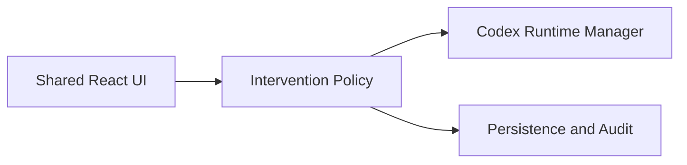

# Intervention Controls

## Overview

The Intervention Controls feature provides live control over active Takomi runs and child sessions. It makes pausing, resuming, cancelling, rerouting, replacing, migrating context, and injecting guidance part of the core product workflow rather than an afterthought.

## Package Ownership

- `packages/contracts`
  - intervention action types
  - intervention request and response schemas
  - intervention audit event payloads
- `packages/orchestration`
  - intervention policy
  - run ownership and scope resolution
  - recovery flow hooks
- `packages/runtime-codex`
  - runtime command implementations
  - run-state synchronization
- `packages/persistence`
  - intervention history
  - run status restore
- `packages/ui`
  - intervention controls
  - pause/request cards
  - recovery prompts

## Core Rules

- Interventions must identify their scope clearly:
  - current run
  - child run
  - session subtree
- The system must record requested, applied, unsupported, and failed intervention outcomes.
- The UI must keep intervention controls close to the active run and the transcript state that prompted them.

## Desktop and Browser Split

### Shared

- The intervention vocabulary and audit model are identical across desktop and browser.

### Desktop

- Local runs route intervention commands through Electron main to the local runtime host.

### Browser

- Remote runs route intervention commands through the remote runtime contract.
- If an intervention is unsupported by the active backend, the UI must show that explicitly and log the outcome.

## Data Flow

## Audit Events

- `intervention.requested`
- `intervention.applied`
- `intervention.unsupported`
- `intervention.failed`

## Acceptance Notes

- Intervention state must survive reload and remain correlated to the owning run.
- Pause/resume/cancel are table-stakes.
- Guidance injection, reroute, replace, and migrate must fit the same action model even if backend support is phased.
