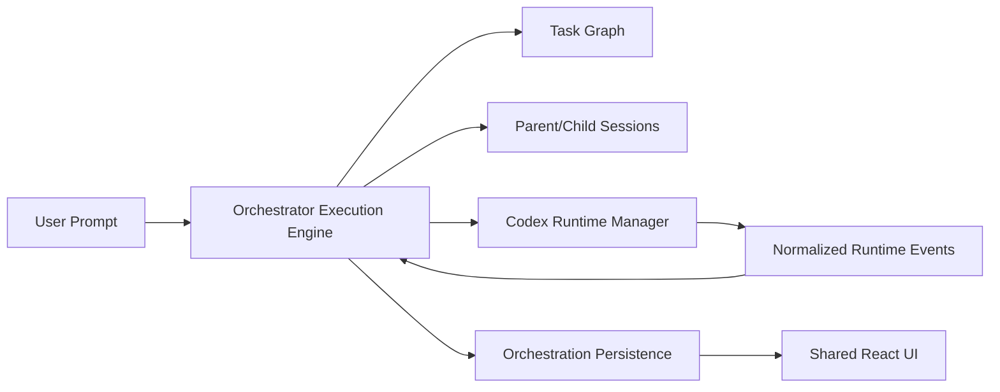

# Orchestrator Execution Engine

## Overview

The orchestrator execution engine owns Takomi task-graph execution state. It models orchestration sessions, task dependencies, parent/child session creation, background child runs, artifacts, interventions, and recovery while keeping the shared renderer as a consumer rather than the source of truth.

## Package Ownership

- `packages/contracts`
  - orchestration session entities
  - task graph entities
  - run and artifact correlation ids
- `packages/orchestration`
  - execution scheduler
  - dependency resolution
  - child-session creation
  - recovery rules
  - artifact recording
- `packages/runtime-codex`
  - run dispatch and runtime ownership tracking
- `packages/persistence`
  - orchestration repository
  - task graph snapshots
  - artifact metadata
- `packages/ui`
  - task graph monitor
  - session-tree status badges
  - artifact and recovery surfaces

## Core Responsibilities

- create orchestration sessions
- add tasks and dependency edges
- create child chat sessions for delegated work
- dispatch Codex SDK-backed runs through the runtime manager
- track completion, failure, pause, intervention, and recovery states
- attach artifacts and result documents

## Data Flow

## Product Rules

- The engine remains the state owner for task graph execution.
- Parent/child task relationships and parent/child run relationships must remain explicit.
- Background child runs must not block the parent session.
- Result artifacts must stay correlated to workspace, orchestration session, task, run, and child session identity where applicable.

## Performance Notes

- Task graph recomputation should happen in orchestration or store layers, not inline React rendering.
- Deep trees and frequent event bursts must not trigger full workspace rerenders.
- Result attachment and audit writes should be async and incremental.

## Acceptance Notes

- The engine must preserve Takomi workflows and recovery flows.
- Runtime correlation ids must remain stable across local desktop and remote/browser-safe targets.
- The renderer should be able to restore task state and session lineage from persistence alone.
